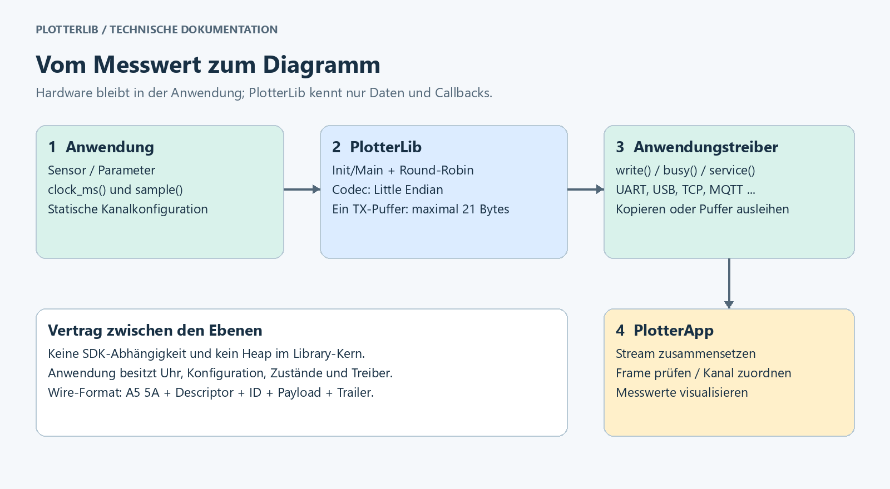
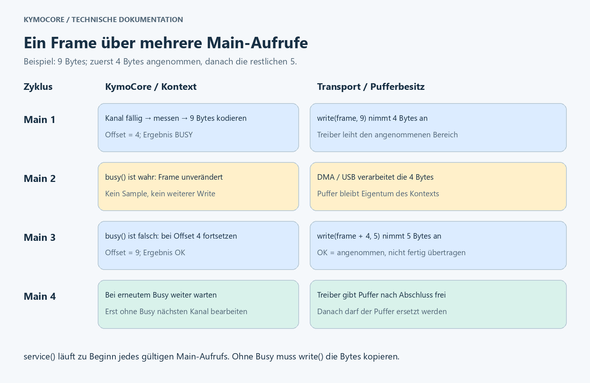
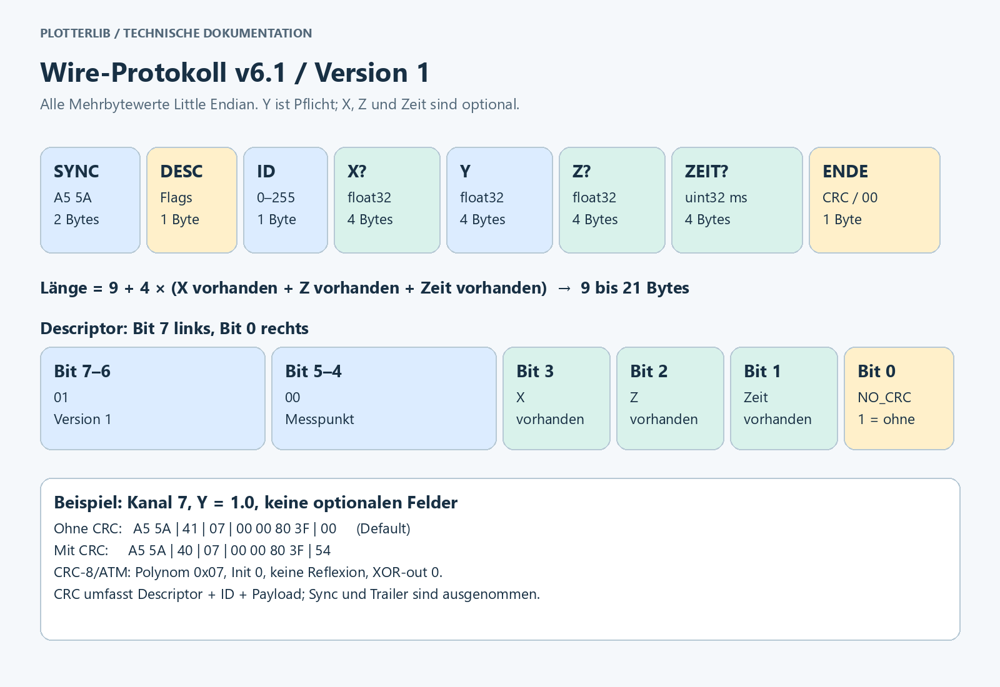

# KymoCore – Anleitung und Referenz

[← Zurück zur Übersicht](../README.de.md) · [English](GUIDE.md) · **Deutsch**

Diese Anleitung erklärt Einrichtung, Datenweg und Protokoll auf Deutsch. Die
anschließende API-Referenz beschreibt die technischen Verträge.

## Architektur und Datenweg



Die Anwendung besitzt Messquellen, Uhr und Transporttreiber. `Kymo_Init`
prüft die Konfiguration und kopiert sie in einen Kontext. `Kymo_Main` wählt
einen fälligen Kanal, ruft den Messcallback auf, kodiert den Messpunkt und
bietet dem Transport die Bytes an. KymoStudio setzt empfangene Fragmente
zusammen und ordnet Messwerte anhand ihrer Kanal-ID zu.

| Ebene | Aufgabe | Schnittstelle |
|---|---|---|
| Anwendung | Sensoren, Hardwareinitialisierung und Verbindung | Eigene Treiber |
| Zeitquelle | Monotone Millisekunden liefern | `clock_ms(user)` |
| Messquelle | Y und bei Bedarf X/Z lesen | `sample(user, id, out)` |
| Scheduler | Fälligkeit, Round-Robin und Rückstau | `Kymo_Init`, `Kymo_Main` |
| Codec | Werte prüfen und Little-Endian-Frame erzeugen | `KymoProtocol_Encode` |
| Transportadapter | Bytes kopieren oder kontrolliert ausleihen | `write`, optional `busy`/`service` |
| KymoStudio | Dekodieren, Signale darstellen und auswerten | [Desktop-Projekt](https://kymotrace.de/#download) |

Die optionale C++-Klasse `KymoSender` ist ein alternativer Push-Sender: Die
Anwendung entscheidet selbst über den Sendezeitpunkt. Beide APIs verwenden
dasselbe Wire-Format. Es gibt keine Messwertwarteschlange im Kern.

## Aufbau der Library

Anwendungen binden **einen Header** ein: `<KymoCore.h>`. Er holt alle Module,
die die Build-Konfiguration aktiviert. Die Quellen sind nach Aufgaben gegliedert:

| Ordner / Header | Modul | Aktiv mit |
|---|---|---|
| `kymo_config.h` | Version, Profil, alle Schalter und Größen | immer |
| `kymo_types.h` | `KymoStatus` und gemeinsame Callback-Typen | immer |
| `telemetry/kymo_protocol.h` | DATA-Frame-Codec (`KymoProtocol_*`) | immer |
| `telemetry/kymo_runtime.h` | `Kymo_Init` / `Kymo_Main` | `KYMO_ENABLE_RUNTIME=1` (Default) |
| `telemetry/kymo_sender.h` | `KymoSender` + `KymoStream` (C++) | `KYMO_ENABLE_CPP=1` |
| `trace/kymo_instrumentation.h` | `KYMO_TRACE_*`-Makros | immer (Compile-out) |
| `trace/kymo_trace.h` | `KymoTraceRecorder` | `KYMO_ENABLE_TRACE=1` |
| `transport/kymo_mux.h` | `KymoMux`: Trace + DATA auf einer Leitung | `KYMO_ENABLE_TRACE=1` |
| `common/` | Bit-, Byte- und CRC-Helfer | immer |

Jede Funktion, die fehlschlagen kann, liefert `KymoStatus`; `KYMO_OK` (0)
bedeutet immer Erfolg. Alle Module nutzen `KymoClockFn`, `KymoWriteFn`,
`KymoBusyFn` und `KymoServiceFn`, sodass ein Transportadapter für Runtime,
Sender und Mux genügt.

**Das gesamte Paket ist plattformunabhängig.** Keine Datei bindet SDK-,
Hersteller- oder Framework-Header ein (kein `Arduino.h`, keine HAL- oder
RTOS-Header), und kein Zielmakro verändert die API. Hardwarezugriff liegt
immer in Callbacks der Anwendung; die Arduino-Sketches unter `examples/` sind
solche Anwendungen.

## Installation mit PlatformIO

KymoCore aus der PlatformIO Registry im Namespace `codename666` installieren:

```ini
[env:esp32dev]
platform = espressif32@6.12.0
board = esp32dev
framework = arduino
monitor_speed = 115200
lib_deps =
    codename666/KymoCore @ 7.0.0
```

Für Uno stattdessen `platform = atmelavr@5.3.0` und `board = uno` setzen.
Die Library selbst ist weder an diese Boards noch an Arduino gebunden.

Bis zur Veröffentlichung in der Registry direkt von GitHub installieren. Der Tag
legt die Version fest:

```ini
lib_deps =
    https://github.com/CodeName-666/kymocore.git#v7.0.0
```

Alternativ aus diesem Repository ein Paket bauen:

```sh
pio pkg pack . -o KymoCore-7.0.0.tar.gz
```

Das Archiv in das eigene Projekt kopieren und dort eintragen:

```ini
lib_deps =
    file://KymoCore-7.0.0.tar.gz
```

Alternativ den vollständigen Library-Ordner nach `lib/KymoCore` des eigenen
Projekts kopieren.

## Vollständiges Arduino- und ESP32-Beispiel

Folgender Inhalt für `src/main.cpp` sendet auf Kanal 0 alle 20 ms einen
synthetischen Sägezahn zwischen 0 und knapp 1. Er verwendet ausschließlich
die Standardeinstellungen. Die serielle Schnittstelle bleibt für Binärdaten
reserviert; Diagnoseausgaben würden denselben Datenstrom verändern.

```cpp
#include <Arduino.h>
#include <KymoCore.h>

static KymoContext context = {};
static KymoStatus lastStatus = KYMO_BAD_CONFIG;
/* period_ms, id, flags: channel 0, every 20 ms, scalar value only. */
static const KymoChannel channels[] = {{20U, 0U, 0U}};

/*******************************************************************************
 * readClockMs
 ******************************************************************************/
static uint32_t readClockMs(void *user)
{
    uint32_t result = static_cast<uint32_t>(millis());
    (void)user;
    return result;
}

/*******************************************************************************
 * readSample
 ******************************************************************************/
static uint8_t readSample(void *user, uint8_t id, KymoSample *out)
{
    uint8_t result = 0U;
    (void)user;
    (void)id;
    if (out != nullptr) {
        out->value = static_cast<float>(millis() % 1000UL) / 1000.0f;
        result = 1U;
    }
    return result;
}

/*******************************************************************************
 * writeBytes
 ******************************************************************************/
static uint8_t writeBytes(void *user, const uint8_t *bytes, uint8_t length)
{
    uint8_t result = 0U;
    int available = Serial.availableForWrite();
    (void)user;
    if ((bytes != nullptr) && (available > 0)) {
        if (available < length) {
            length = static_cast<uint8_t>(available);
        }
        result = static_cast<uint8_t>(Serial.write(bytes, length));
    }
    return result;
}

/*******************************************************************************
 * setup
 ******************************************************************************/
void setup()
{
    KymoConfig config = {};   /* copied by Kymo_Init, may be local */
    Serial.begin(115200);
    config.channels = channels;                     /* what */
    config.channel_count = KYMO_COUNT_OF(channels);
    config.clock_ms = readClockMs;                  /* when */
    config.sample = readSample;                     /* which values */
    config.write = writeBytes;                      /* where to */
    lastStatus = Kymo_Init(&context, &config);
}

/*******************************************************************************
 * loop
 ******************************************************************************/
void loop()
{
    if ((lastStatus != KYMO_BAD_CONFIG) && (lastStatus != KYMO_IO_ERROR)) {
        lastStatus = Kymo_Main(&context);
    }
}
```

`int available` folgt dem Rückgabetyp der Arduino-API; vor der Verengung wird
der Wertebereich geprüft. Serial kopiert die angenommenen Bytes; deshalb ist
hier kein Busy-Callback nötig. Die tatsächliche Ausführungszeit hängt vom
Serial-Treiber ab. Den Messcallback später durch den Sensorzugriff ersetzen.

Mit `pio run` bauen, anschließend mit `pio run -t upload` auf das angeschlossene
Board übertragen. KymoStudio mit 115200 Baud und 8N1 verbinden und Kanal 0
einem Diagramm zuordnen. Einen geöffneten seriellen Monitor vorher schließen.
Ein vollständig SDK-freies, ausführbares Beispiel liegt in
[examples/basic](../examples/basic/README.md).

## Features und Konfiguration

Alle Einstellungen stehen in **`src/kymo_config.h`**. Vorrang: Compilerdefinitionen
(`-D...`) vor einem optionalen Projektheader (`KYMO_USER_CONFIG_HEADER`), dieser
vor dem Profil, dieses vor den Library-Defaults. Für installierte
Registry-Pakete sind projektweite `build_flags` die reproduzierbare Wahl.

**Profile** setzen sinnvolle Defaults in einem Schritt; jeder Schalter bleibt
einzeln überschreibbar:

| Profil | Aktiviert |
|---|---|
| `KYMO_PROFILE_MINIMAL` (Default) | Skalare Y-Werte, Init/Main-Runtime |
| `KYMO_PROFILE_XYZ` | X, Z und Zeitstempel |
| `KYMO_PROFILE_TRACE` | XYZ plus Trace-Recorder mit ISR-, Scheduler- und Flow-Ereignissen |

```ini
build_flags =
    -DKYMO_PROFILE=KYMO_PROFILE_XYZ
    -DKYMO_ENABLE_CRC=1
```

| Schalter | Default | Wirkung bei 1 |
|---|---:|---|
| `KYMO_ENABLED` | 1 | 0 kompiliert die gesamte Library heraus |
| `KYMO_ENABLE_RUNTIME` | 1 | Init/Main-Scheduler |
| `KYMO_ENABLE_CPP` | 0 | C++-Push-Sender `KymoSender` |
| `KYMO_ENABLE_X` | Profil | Optionale X-Koordinate |
| `KYMO_ENABLE_Z` | Profil | Optionale Z-Koordinate, unabhängig von X |
| `KYMO_ENABLE_TIMESTAMP` | Profil | Zeitstempel auf dem Draht |
| `KYMO_ENABLE_CRC` | 0 | Ausgehende CRC berechnen |
| `KYMO_ENABLE_DECODER` | 0 | Vollständige Frames auf dem MCU dekodieren |
| `KYMO_ENABLE_TRACE` | Profil | Trace-Recorder, Instrumentierung und Mux |
| `KYMO_ENABLE_TRACE_ISR` | Profil | ISR-Ereignisse (braucht TRACE) |
| `KYMO_ENABLE_TRACE_SCHEDULER` | Profil | Task-Ereignisse (braucht TRACE_ISR) |
| `KYMO_ENABLE_TRACE_FLOW` | Profil | Flow-Korrelation (braucht TRACE) |

| Größe | Default | Bereich |
|---|---:|---|
| `KYMO_MAX_CHANNELS` | 16 | 1–256 Kanäle pro Kontext, je 4 Bytes |
| `KYMO_TRACE_EVENTS_PER_CORE` | 64 | Zweierpotenz, 16–4096 |
| `KYMO_TRACE_CORE_COUNT` | 1 | 1–2 |
| `KYMO_TRACE_MAX_CONTEXTS` | 16 | 1–256 |
| `KYMO_TRACE_MAX_DEPTH` | 32 | 1–255 |
| `KYMO_TRACE_MAX_ISR_DEPTH` | 8 | 1–16 |
| `KYMO_MUX_ADMIN_RECORD_MAX` | 512 | 64–8192 Bytes |

Feature-Aktivierung erlaubt ein Feld; die Flags des jeweiligen Kanals wählen
es für dessen Frame aus. XYZ mit Zeitstempel verwendet `KYMO_ALLOWED_FLAGS`,
nur Zeitstempel `KYMO_FLAG_TIMESTAMP`. Der Callback setzt X/Z; die Runtime
berechnet die Zeit seit Init. Alle Einheiten gemeinsam neu bauen: Ein Define
allein im Sketch konfiguriert separat übersetzte Library-Dateien nicht.

Nur 0 und 1 sind erlaubt; ungültige Werte und fehlende Abhängigkeiten brechen
den Build ab. Deaktivierte Implementierungen werden herauskompiliert.
Unzulässige Feldanforderungen werden abgewiesen, nicht still entfernt. Der
MCU-Decoder prüft geschützte Eingaben auch bei deaktivierter ausgehender CRC.
Im Anwendungscode schützen die `KYMO_EFFECTIVE_*`-Makros optionale Ressourcen.

## Scheduling und Übertragungsablauf



Es sind 1–256 eindeutige Kanal-IDs möglich. Perioden reichen von 0 bis
`INT32_MAX` ms; 0 bedeutet bei jeder möglichen Auswahl. Nach Init sind alle
Kanäle sofort fällig. Main prüft höchstens N Kanäle und ruft höchstens einmal
den Messcallback und einmal Write auf. Round-Robin verhindert dauerhafte
Verdrängung. Main häufiger als die Summe der gewünschten Abtastraten aufrufen;
kurze Writes benötigen weitere Aufrufe.

Pro Kontext existiert **ein 21-Byte-TX-Puffer**, daneben weitere Kontextfelder
und **4 Bytes Scheduling-Zustand pro Kanal**. Der gesamte Kontext ist größer
als 21 Bytes und ABI-abhängig. Konfiguration, Stack und Treiberpuffer kommen hinzu.
Ein ausstehender Frame behält seinen Messwert. Danach werden aktuelle Werte
abgefragt; ausgefallene Abtastungen werden nicht rekonstruiert.

`write(user, bytes, length)` meldet die Anzahl angenommener Bytes. Null heißt
später erneut versuchen; ein kurzer Write verschiebt den Offset. Der nächste
Main-Aufruf setzt am Rest fort. Eine Rückgabe größer als die angeforderte
Länge verriegelt `KYMO_IO_ERROR` bis zur sicheren Neuinitialisierung.

Bei synchroner Übertragung muss der Callback angenommene Bytes vor Rückkehr
kopieren oder verbrauchen. Bei DMA/USB darf der Treiber den Zeiger behalten,
wenn `busy(user)` bis zur Freigabe ungleich null bleibt. Währenddessen wird
der Puffer nicht überschrieben. `KYMO_OK` bedeutet Annahme durch den Treiber,
nicht physische Fertigstellung oder Empfangsbestätigung. `service(user)` läuft
zu Beginn jedes gültigen Main-Aufrufs, auch bei Busy und verriegeltem Fehler.

Kymo_Init kopiert die Konfiguration; nur Kanaltabelle und User-Kontexte
müssen den Kontext überleben. Jede Instanz besitzt ihren eigenen Kontext, der
auch den Zeitplan pro Kanal enthält. APIs sind nicht
reentrant; Task-/ISR-Synchronisierung übernimmt die Anwendung. Nicht neu
initialisieren oder zerstören, solange ein Treiber den Puffer leiht. Bei
Teilframes dürfen andere Produzenten keine Bytes in denselben Stream mischen.

## Protokoll und Byte-Aufbau



Paketversion 7.0.0, Protokoll v6.2 und **Wire-Version 1** sind unterschiedliche
Angaben. Der normative Vertrag steht in [PROTOCOL.md](../PROTOCOL.md).

| Offset | Größe | Inhalt |
|---|---:|---|
| 0 | 1 Byte | Sync `A5` |
| 1 | 1 Byte | Sync `5A` |
| 2 | 1 Byte | Descriptor |
| 3 | 1 Byte | Kanal-ID 0–255 |
| 4 | 0/4 Bytes | Optionales X |
| 4 oder 8 | 4 Bytes | Y, immer vorhanden |
| nach Y | 0/4 Bytes | Optionales Z |
| nach Z beziehungsweise Y | 0/4 Bytes | Optionale Zeit in ms oder µs |
| letztes Byte | 1 Byte | CRC-8/ATM oder Null-Trailer |

Die Payload-Reihenfolge ist **X? → Y → Z? → Zeit?**. X/Y/Z sind endliche
IEEE-754-Float32-Werte; NaN und Unendlich werden abgewiesen. Zeit ist ein
unsigned 32-Bit-Millisekundenwert relativ zum Senderstart und läuft nach
ungefähr 49,7 Tagen über. Mit dem Mikrosekundenbit zählt sie µs und läuft
nach ungefähr 71,6 Minuten über. Mehrbytewerte sind Little Endian: niederwertigstes
Byte zuerst. Es werden keine gepackten C-Strukturen direkt übertragen.

| Descriptorbits | Bedeutung |
|---|---|
| 7–6 | `01` = Wire-Version 1 |
| 5 | `0` = Messpunkt |
| 4 | Zeiteinheit: 0 = ms, 1 = µs (nur mit Bit 1) |
| 3 | X vorhanden |
| 2 | Z vorhanden |
| 1 | Zeitstempel vorhanden |
| 0 | `NO_CRC`: 1 ohne CRC, 0 mit CRC |

Gültig sind `0x40` bis `0x4F`: gerade Werte mit CRC, ungerade ohne CRC.
`0x52`/`0x53`, `0x56`/`0x57`, `0x5A`/`0x5B` und `0x5E`/`0x5F` sind dieselben
Layouts mit Mikrosekundenzeit; `0x50`, `0x54`, `0x58` und `0x5C` (µs ohne Zeit,
samt NO_CRC-Varianten) sind ungültig. Für `KymoProtocol_Encode` am `KymoDataPoint`
`KYMO_FLAG_TIMESTAMP | KYMO_FLAG_TIMESTAMP_US` setzen. Die Kanal-Runtimes nutzen
Millisekundenuhren und weisen das µs-Flag ab. Empfänger vor KymoCore 6.4 /
KymoStudio 2.5 weisen µs-Frames als unbekannten Nachrichtentyp ab.
Andere Versionen und Nachrichtentypen werden abgewiesen. Firmware-Features
können die unterstützten Layouts weiter einschränken.

**Länge = 9 + 4 × (X vorhanden + Z vorhanden + Zeit vorhanden)**, wobei
jeder Summand 0 oder 1 ist. Ein separates Längenbyte ist nicht nötig.

| Layout | Ohne Zeit | Mit Zeit |
|---|---:|---:|
| Y | 9 Bytes | 13 Bytes |
| XY | 13 Bytes | 17 Bytes |
| YZ | 13 Bytes | 17 Bytes |
| XYZ | 17 Bytes | 21 Bytes |

### Konkrete Frames

Kanal 7, Y = 1,0, ohne Zeit und ohne CRC:

```text
A5 5A | 41 | 07 | 00 00 80 3F | 00
Sync    Desc ID   Y = 1.0        Trailer
```

`0x41 = 01000001`: Version 1, Messpunkt, keine optionalen Felder, NO_CRC
gesetzt. `00 00 80 3F` ist Little Endian für Float32 `0x3F800000`.
Mit CRC lautet der Frame `A5 5A 40 07 00 00 80 3F 54`.

Kanal 3, X = 1,25, Y = −2,5, Z = 9,0, Zeit = 1234 ms:

```text
A5 5A | 4F | 03 | 00 00 A0 3F | 00 00 20 C0 | 00 00 10 41 | D2 04 00 00 | 00
Sync    Desc ID   X = 1.25      Y = -2.5      Z = 9.0       Zeit = 1234   Trailer
```

Der volle Frame hat 21 Bytes. Mit CRC wird `4F` zu `4E` und das letzte Byte
zu `89`. Die Python-Datenpunkte der App repräsentieren die Wire-Millisekunden
als Sekunden: 1234 ms entsprechen 1,234 s.

### CRC und Wiederaufnahme

CRC ist standardmäßig deaktiviert. Der Sender setzt NO_CRC und schreibt
ein Null-Trailerbyte. Der Empfänger ignoriert dessen Wert. Sync-, Descriptor-,
Längen- und Endlichkeitsprüfungen bleiben aktiv, erkennen aber nicht jede
Beschädigung: Ein verfälschter endlicher Messwert kann passieren.

Mit `KYMO_ENABLE_CRC=1` gilt CRC-8/ATM: Polynom `0x07`, Startwert `0x00`,
keine Reflexion, XOR-out `0x00`. Geschützt werden **Descriptor, ID und Payload**;
Sync und CRC-Byte selbst sind ausgenommen. ASCII `123456789` ergibt `F4`.
Nach ungültigen Frames sucht der Desktop-Streamdecoder erneut nach `A5 5A`.
Read-Grenzen des Transports sind keine Framegrenzen.

Ältere v6.0-Empfänger akzeptieren NO_CRC nicht. Daher einen entsprechend
aktualisierten App-Stand verwenden oder CRC einschalten. Der aktuelle
Desktop-Decoder verarbeitet beide Modi auch gemischt. Der optionale
MCU-Decoder erwartet einen vollständigen Frame; er ist kein Streamassembler.

## Transporte und Dimensionierung

| Transport | Anbindung durch die Anwendung | Framing |
|---|---|---|
| UART / Serial | Kopierender Write oder DMA plus Busy | Teilframes möglich |
| USB CDC | Kopieren oder Puffer ausleihen plus Busy | USB-Pakete sind keine Framegrenzen |
| TCP | Socket-Write, optional Service | Zusammenhängender Bytestrom |
| UDP | Socket-`sendto` im Write-Callback | Ein ganzer Frame je Datagramm oder 0 melden |
| MQTT | Netzwerkdienst und Publish-Callback | Ganzen Frame annehmen oder 0 melden |
| CAN-FD | Ganzen Frame in Datenfeld einbetten | Padding vor dem Dekodieren entfernen |
| Classic CAN | Eigenes kompaktes Mapping | Kein 9–21-Byte-Frame im 8-Byte-Paket |

Classic CAN verwendet eine Kanalzuordnung über Arbitration-ID beziehungsweise
Adapterkonfiguration und ein konfiguriertes Zahlenformat. Details stehen im
[Protokollvertrag](../PROTOCOL.md#can). Netzwerkaufbau und Wiederverbindung gehören
zum Adapter. Das externe PubSubClient-Beispiel verbindet synchron und ist
deshalb kein Nachweis für einen harten Echtzeitzyklus.

UART mit 115200 Baud und 8N1 benötigt zehn Leitungsbits pro Byte. Theoretisch
sind 11.520 Bytes/s möglich: etwa 1.280 Y-Messpunkte/s oder 548 XYZ-Messpunkte/s
mit Zeitstempel, jeweils ohne weitere Pausen oder Treiberkosten. Zehn Kanäle
mit je 100 Hz benötigen als reine Y-Frames 9.000 Bytes/s; mit Zeitstempel
13.000 Bytes/s und damit mehr als dieser UART tragen kann. Messrate,
Main-Aufruffrequenz und Transport gemeinsam dimensionieren.

## KymoStudio verbinden

Die zugehörige Desktop-Anwendung ist
**[KymoStudio](https://kymotrace.de/#download)**; der Windows-Installer
steht auf der Download-Seite bereit.
Die Library liefert Telemetrie; die App übernimmt Empfang und Visualisierung.

1. Einen App-Decoder mit v6.1/NO_CRC-Unterstützung verwenden oder Firmware-CRC
   aktivieren. Ältere App-Versionen unterstützen das eventuell nicht.
2. Firmware übertragen und den Eingang in der App konfigurieren: beispielsweise
   Serial mit 115200 Baud/8N1, UDP auf dem Port, an den die Firmware sendet,
   oder MQTT mit dem Topic des Publishers.
3. Die Kanal-ID einem Signal/Diagramm zuordnen. Y ist der Messwert; X/Z sind
   optionale Koordinaten. Ohne X wird kein gemessener X-Wert übertragen.
4. Zunächst die bekannte Beispielwellenform prüfen, dann Sensoren anbinden.

Das Protokoll überträgt keine Kanalnamen, Einheiten oder Sensorkonfigurationen.
Diese Zuordnung bleibt bei Anwendung und App. Ein Rückkanal für Steuerbefehle
ist nicht Teil von v6.2. Legacy-JSON kann die App zusätzlich empfangen;
KymoCore kodiert binär.

## Paketstruktur und Prüfung

```text
KymoCore/
  library.json             PlatformIO-Metadaten und Exportumfang
  library.properties       Arduino-Metadaten
  LICENSE                  GPLv3-Lizenztext
  COMMERCIAL.md            Doppellizenz: GPLv3 oder kommerziell
  CONTRIBUTING.md          Beiträge und Rechteeinräumung
  README.md                Übersicht und Schnellstart (Englisch, README.de.md Deutsch)
  PROTOCOL.md              Normativer Wire-Vertrag
  CHANGELOG.md             Änderungen und Migration
  PUBLISHING.md            Release-Vorbereitung für Maintainer
  src/
    KymoCore.h             Der eine Header für Anwendungen
    kymo_config.h          Version, Profil, Schalter und Größen
    kymo_types.h           Statuscodes und gemeinsame Callback-Typen
    telemetry/             Codec, Init/Main-Runtime, C++-Sender
    trace/                 Recorder, Trace-Protokoll, Instrumentierung
    transport/             Mux für Trace + DATA auf einer Leitung
    common/                Bit-, Byte- und CRC-Helfer
  examples/                Portable und Arduino-Referenzbeispiele
  test/                    Native Tests und Strukturprüfung
  tools/configurator/      Projekt-Konfigurator
  docs/                    Anleitung (Englisch/Deutsch) und Bilder
```

Die komplette Host-Suite aus dem Repository-Wurzelverzeichnis starten:

```sh
python test/native_test.py
python tools/test_package.py
```

`native_test.py` baut und startet die Hilfsfunktionen, die Protokoll-Golden-Vectors
mit und ohne CRC, die Telemetrie-Runtime in vier Konfigurationen, den
C++-Sender, den C-Einstiegsheader in jedem Profil, das portable Beispiel, die
Trace-Recorder/Mux-Suite, die Compile-out-Suite und die Single-Return-Strukturprüfung.
Der Paketcheck baut separate Verbraucher aus dem exportierten Archiv und
kompiliert das README-Beispiel für Uno und ESP32. Builds ersetzen keine
Boardtests, Stackmessungen oder Zeitmessungen im Treiber. Eigene Adapter auf
Zielhardware validieren. Die Paketvorbereitung steht in
[PUBLISHING.md](../PUBLISHING.md), Änderungen in [CHANGELOG.md](../CHANGELOG.md).

## Technische API-Referenz

Die folgende Referenz beschreibt Compiler-, Konfigurations- und Besitzverträge.

`KymoCore.h` einbinden. Die Implementierung wird als C++11 oder neuer gebaut,
ohne Heap, Exceptions oder RTTI. Alle C-Einstiegspunkte behalten C-Linkage,
sodass C99-Anwendungen und -Callbacks die Library nutzen können. Gemischte
C/C++-Anwendungen mit der C++-Toolchain linken. PlatformIO und die Arduino-IDE
übersetzen die Unterordner von `src/` automatisch; eigene Builds übersetzen
alle `src/**/*.cpp` mit `-std=c++11 -fno-exceptions -fno-rtti` und nehmen
`src/` in den Include-Pfad auf.

## Statuscodes

| Status | Bedeutung |
| --- | --- |
| `KYMO_OK` | Erfolg: Konfiguration angenommen, Frame vollständig angenommen, Ereignis kopiert, Record eingereiht |
| `KYMO_IDLE` | Nichts zu tun: kein Kanal fällig, kein Ereignis vorhanden, Mux hat nichts zu senden |
| `KYMO_BUSY` | Transport belegt, Frame teilweise geschrieben oder Einzelplatz belegt; erneut aufrufen |
| `KYMO_SKIPPED` | Sample-Callback lieferte null |
| `KYMO_BAD_SAMPLE` | Nicht-endliche Koordinate, nicht unterstützte Flags oder ungültiger Frame |
| `KYMO_BAD_CONFIG` | Ungültiges Argument/Konfiguration oder nicht initialisiertes Objekt |
| `KYMO_IO_ERROR` | Unmögliche Schreibanzahl; Fehler bis Reparatur und Neuinitialisierung verriegelt |
| `KYMO_REJECTED` | Anfrage im aktuellen Zustand abgelehnt (z. B. Trace-Kontext noch offen) |

`KYMO_OK` von Main heißt: Der Treiber hat den Frame angenommen – keine Zustellbestätigung.

## Minimaler Build und optionale Features

Der Default-Build enthält skalare Y-Kodierung und die Init/Main-Runtime.
Optionale Implementierungen entfernt der Präprozessor, sie werden nicht nur
zur Laufzeit abgeschaltet. `KYMO_ENABLE_RUNTIME=0` ergibt einen reinen
Encoder-Build; mit `KYMO_ENABLE_CPP=1` zusätzlich einen Push-Sender ohne
Scheduler. Mit `KYMO_ENABLED=0` trägt die Library keinerlei Symbole bei;
anwendungseigene Telemetrie-Ressourcen mit `KYMO_EFFECTIVE_*` schützen und
die `KYMO_TRACE_*`-Makros verwenden, die zu No-ops werden. Ungeschützte direkte
API-Aufrufe brechen im Off-Build bewusst den Build ab.

Deaktivierte X/Z/Zeit-Flags liefern null von `KymoProtocol_Encode`,
`KYMO_BAD_CONFIG` von Init und `KYMO_BAD_SAMPLE` beim Dekodieren und im
C++-Sender. Felder werden nie still entfernt. `KYMO_ALLOWED_FLAGS` beschreibt
das Wire-Protokoll, `KYMO_SUPPORTED_FLAGS` diesen Build. KymoStudio akzeptiert
alle Wire-Layouts unabhängig von der Firmware-Auswahl.

Puffergrenzen, Endlichkeitsprüfungen, Short-Write-Behandlung und asynchroner
Pufferbesitz bleiben verpflichtend. Der größte Frame bleibt 21 Bytes; die
Schalter sparen Code, `KYMO_MAX_CHANNELS` bestimmt die Kontextgröße.

## Runtime-Konfiguration

```c
#include <KymoCore.h>

static uint32_t clock_ms(void *user);  /* monotone Millisekundenuhr */
static uint8_t read_sample(void *user, uint8_t id, KymoSample *out);
static uint8_t write_bytes(void *user, const uint8_t *bytes, uint8_t length);

static const KymoChannel channels[] = {
    /* period_ms, id, flags */
    {20, 0, 0},
    {100, 1, 0}
};
static KymoContext kymo;

KymoStatus kymo_setup(void)
{
    KymoConfig config = {0};             /* wird von Kymo_Init kopiert */
    config.channels = channels;          /* Pflicht */
    config.channel_count = KYMO_COUNT_OF(channels);
    config.clock_ms = clock_ms;          /* Pflicht */
    config.sample = read_sample;         /* Pflicht */
    config.write = write_bytes;          /* Pflicht */
    /* optional: busy, service, clock_user, sample_user, transport_user */
    return Kymo_Init(&kymo, &config);
}

/* Aus der bestehenden zyklischen Task: */
void kymo_cycle(void) { (void)Kymo_Main(&kymo); }
```

`read_sample` setzt `out->value` und optional `out->x` / `out->z`; die Rückgabe
null überspringt eine Messung bis zum nächsten Intervall. Gemeinsame
Anwendungsparameter erreicht der Callback über `sample_user`. Die Runtime
setzt alle Felder vor dem Aufruf auf null. Hardware-Handles gehören in
`transport_user`, Uhren können `clock_user` nutzen.

`Kymo_Init` kopiert die Konfiguration; das `KymoConfig`-Objekt darf also lokal
sein. Kanaltabelle und alle User-Kontexte müssen gültig und unverändert
bleiben. Jede Instanz braucht einen eigenen `KymoContext`, der auch den
Zeitplan pro Kanal enthält. Die Hardwareinitialisierung bleibt Aufgabe der Anwendung.

## Scheduling und Speicher

- 1–`KYMO_MAX_CHANNELS` Kanäle (bis 256) mit eindeutigen Byte-IDs.
- Perioden sind uint32-Millisekunden bis INT32_MAX; null bedeutet bei jedem
  möglichen Main-Aufruf. Die ersten Messungen sind sofort fällig.
- Ein fester **21-Byte-TX-Puffer** und **4 Bytes Zustand pro möglichem Kanal**
  in jedem Kontext, dazu die Konfigurationskopie. Keine Warteschlange, kein Heap.
- Höchstens ein Sample-Callback und ein Write pro Main; höchstens N
  Kanalprüfungen. Round-Robin verhindert Verdrängung. Main häufiger aufrufen
  als die Summe der Abtastraten; kurze Writes brauchen zusätzliche Aufrufe.
- Langsame Transporte erzeugen Rückstau. Ein ausstehender Frame behält Wert und
  Zeitstempel; danach messen überfällige Kanäle aktuelle Werte. Verpasste
  Messungen werden nicht nachgeholt.
- uint32-Subtraktion behandelt den Uhrenüberlauf. Main mindestens einmal
  innerhalb von INT32_MAX ms aufrufen. Wire-Zeitstempel laufen nach etwa 49,7 Tagen über.
- Alle Einstiegspunkte sind nicht reentrant. Mit Interrupts geteilte Werte
  synchronisiert die Anwendung. Nicht neu initialisieren, solange DMA/USB einen Puffer leiht.
- Explizite Byte-Kodierung vermeidet gepackte Strukturen sowie Enum-Breiten- und
  Endian-Abhängigkeiten. IEEE-754-binary32 ist Pflicht; keine fast-math-Modi.

## Transport callbacks

`write(user, bytes, length)` returns **accepted bytes**, from zero to length.
Zero means retry later. Short writes resume at their remaining offset. A driver
must never consume bytes it reports as unaccepted. More than length is a
contract error: Main latches IO_ERROR until reinitialization after driver reset.

Synchronous drivers copy/consume bytes before returning. Asynchronous UART/DMA
or CubeMX CDC may borrow the pointer only with a `busy(user)` callback that
stays nonzero until completion. Main neither rewrites nor advances the pending
buffer while busy. A disconnected driver can also report busy. Never mix other
producers into the same byte stream while a frame is partially written.

Optional `service(user)` runs once at the beginning of every valid Main call,
including busy/faulted calls. Use it to maintain network connections. All
callbacks need bounded execution for real-time use; the core cannot make a
blocking driver asynchronous. The PubSubClient example has synchronous network
connection attempts and is therefore not suitable for hard real-time loops.

UDP/MQTT/CAN-FD adapters must accept an entire frame or return zero; individual
messages cannot contain arbitrary frame fragments. UDP gives no delivery or
order guarantee: a lost datagram loses its frames, never the following ones. TCP/UART/USB streams allow
partial writes. CAN-FD padding must be removed before decoding a complete frame
in an adapter; Classic CAN uses the separate mapping described in PROTOCOL.md.

| Main result | Meaning |
| --- | --- |
| KYMO_OK | Complete frame accepted by driver; not a delivery acknowledgement |
| KYMO_IDLE | No sample due |
| KYMO_BUSY | Transport busy or a frame remains partially written |
| KYMO_SKIPPED | Sample callback returned zero |
| KYMO_BAD_SAMPLE | Non-finite required coordinate; measurement skipped |
| KYMO_BAD_CONFIG | Null/uninitialized context or invalid Init configuration |
| KYMO_IO_ERROR | Impossible write count; fault latched until repair/reinit |

## Optionaler C++-Push-Sender

Mit `KYMO_ENABLE_CPP=1` übersetzen und die gewünschten X/Z/Zeit-Features
aktivieren. Einen `KymoStream`-Adapter für den Transport ableiten und an
`KymoSender` übergeben:

```cpp
class UartStream : public KymoStream {
public:
    size_t write(const uint8_t *data, size_t length) override { /* Treiber */ }
};
static UartStream uart;
static KymoSender sender(uart);

void setup() { sender.setClock(read_clock_ms); }      /* KymoClockFn */
void loop()
{
    if (sender.flush() == KYMO_OK) {                   /* voriger Frame fertig */
        (void)sender.send(0, read_sensor(), true);     /* Wert + Zeitstempel */
    }
}
```

`send`, `send2D` und `send3D` liefern `KYMO_OK`, sobald der Punkt im einzigen
Framepuffer angenommen ist. Danach `flush()` zyklisch aufrufen, bis es
`KYMO_OK` liefert. Solange ein Frame aussteht, werden neue Punkte mit
`KYMO_BUSY` abgelehnt. Ungültige Daten oder deaktivierte Felder ergeben
`KYMO_BAD_SAMPLE`, ein fehlender Stream `KYMO_BAD_CONFIG`; eine zu große
Treiberrückmeldung verriegelt `KYMO_IO_ERROR` bis `begin()`.

`KymoStream::busy()` liefert standardmäßig false; `write` muss dann kopieren.
Für geliehene Puffer überschreiben. `KymoSender` ist nicht kopierbar;
Übertragungen vor `begin()` oder Zerstörung stoppen. Die zyklische C-API
übernimmt das Scheduling automatisch und wird für neue Integrationen empfohlen.

## Execution-Tracing und Transport-Mux

Mit `KYMO_ENABLE_TRACE=1` (oder `KYMO_PROFILE_TRACE`) zeichnet
`KymoTraceRecorder` Scope-, Marker-, ISR-, Task- und Flow-Ereignisse in feste
Ringe pro Kern auf; `KymoMux` sendet sie zusammen mit Verwaltungsrecords und
Telemetrie-Frames über eine Leitung. Pflicht ist nur die Recorder-Uhr:

```c
static KymoTraceRecorder recorder;
static KymoMux mux;
static KymoMuxDataSlot slot;               /* Übergabe Runtime -> Mux */

void trace_setup(void)
{
    KymoTraceConfig trace = {0};
    KymoMuxConfig link = {0};
    KymoConfig telemetry = {0};
    trace.clock_ticks = read_cycle_counter;          /* Pflicht */
    (void)KymoTrace_Init(&recorder, &trace);
    (void)KymoMuxDataSlot_Init(&slot);
    link.recorder = &recorder;                       /* Pflicht */
    link.write = uart_write;                         /* Pflicht */
    link.next_data = KymoMuxDataSlot_NextData;
    link.data_user = &slot;
    (void)KymoMux_Init(&mux, &link);
    /* ...Kanäle, Uhr und Sample wie oben... */
    telemetry.write = KymoMuxDataSlot_Write;
    telemetry.busy = KymoMuxDataSlot_IsBusy;
    telemetry.transport_user = &slot;
    (void)Kymo_Init(&kymo, &telemetry);
}

void cycle(void)
{
    KYMO_TRACE_SCOPE(&recorder, 1u, SYMBOL_CYCLE);   /* C++; sonst ENTER/EXIT */
    (void)Kymo_Main(&kymo);
    (void)KymoMux_Service(&mux);
}
```

`core_id`, `current_context` und das Critical-Section-Paar sind optional.
Ohne Critical-Callbacks serialisiert die Anwendung alle Recorder-Zugriffe.
Das Wire-Format beschreibt [TRACE_PROTOCOL.md](TRACE_PROTOCOL.md).

## Plattformunabhängigkeit

Die gesamte Library einschließlich der C++-Wrapper hat keine Hersteller- oder
SDK-Abhängigkeit und keine zielabhängige API. Sie kennt nur Standard-C/C++-Typen,
konfigurierte Callbacks und den abstrakten `KymoStream`. Hardwareadapter gehören
zur Anwendung. Jedes kleine Arduino-Beispiel enthält seine Callbacks im eigenen,
in sich geschlossenen Sketch. Größere Transport-, Performance- und
Trace-Anwendungen liegen in KymoProbe und sind nicht Teil dieses Pakets.

## Kompatibilität und Prüfung

Der [Wire-Vertrag](../PROTOCOL.md) ist **v6.2 / Wire-Version 1** und bleibt mit
KymoCore 7.0 unverändert. CRC ist **standardmäßig deaktiviert**. Descriptor-Bit 0
markiert NO_CRC; das letzte Byte bleibt als Null-Trailer erhalten, Frames bleiben
9–21 Bytes lang. Decoder ignorieren den Trailer bei NO_CRC und prüfen CRC-Frames weiterhin.

Sender-CRC mit `-DKYMO_ENABLE_CRC=1` für die ganze Library aktivieren (PlatformIO:
`build_flags = -DKYMO_ENABLE_CRC=1`). Ein Define nur im Anwendungsquelltext
konfiguriert separat übersetzten Library-Code nicht. Für den Default-Modus das
aktuelle KymoStudio verwenden; ältere Empfänger brauchen aktivierte CRC.

`python test/native_test.py` prüft den Minimal-Build und die Profile, darunter
fehlende Symbole deaktivierter Module, Ablehnung ungültiger Schalter-, Profil-
und Größenwerte, Codec-Grenzen/CRC/Flags, Round-Robin, kurze Writes, belegte
Transporte, Fehlerverriegelung, Konfigurationskopie und die Wire-Vektoren von
Trace-Recorder und Mux.

## Migration von KymoCore 6.x

KymoCore 7.0 ändert Struktur und Namen, nicht das Wire-Format oder den Funktionsumfang.

| 6.x | 7.0 |
|---|---|
| `#include <kymo_runtime.h>` usw. | `#include <KymoCore.h>` |
| `kymo_build_config.h`, `kymo_features.h`, `kymo_version.h` | `kymo_config.h` |
| `KymoConfig.last_sample_ms` + eigenes Array | entfällt; Zustand liegt in `KymoContext` (`KYMO_MAX_CHANNELS`) |
| `KymoConfig` muss den Kontext überleben | wird von `Kymo_Init` kopiert; darf lokal sein |
| Positionaler `KymoConfig`-Initialisierer | Feldreihenfolge geändert; Felder per Name setzen |
| `kymo_encode_data` / `kymo_decode_data` | `KymoProtocol_Encode` / `KymoProtocol_Decode` (liefert `KymoStatus`) |
| `kymo_frame_length` / `kymo_crc8` | `KymoProtocol_FrameLength` / `KymoProtocol_Crc8` |
| `Kymo`, `kymo.h`, `kymo_stream.h` | `KymoSender`, `telemetry/kymo_sender.h` (enthält `KymoStream`) |
| `send*()` / `flush()` liefern `bool` | liefern `KymoStatus` (`KYMO_OK` = angenommen/fertig) |
| `setMillisecondCallback(uint32_t (*)())` | `setClock(KymoClockFn, void *user)` |
| `KymoTrace_Init/Pop/ContextReset` liefern 1/0 | liefern `KymoStatus` (`KYMO_OK`, `KYMO_IDLE`, `KYMO_REJECTED`) |
| `KymoTraceMux*`, `kymo_transport_mux.h` | `KymoMux*`, `transport/kymo_mux.h` |
| `KymoTraceMux_Service` liefert 0/1/2 | liefert `KYMO_IDLE`/`KYMO_BUSY`, `KYMO_OK`, `KYMO_IO_ERROR` |
| `KymoTraceMuxConfig.write_frame/is_busy/user` | `write`, `busy` (optional), `transport_user`, dazu `data_user` |
| `KymoTraceDataAdapter_*` | `KymoMuxDataSlot_*` |
| `KYMO_TRACE_ADMIN_RECORD_MAX` | `KYMO_MUX_ADMIN_RECORD_MAX` |
| `KymoTraceConfig.core_id/current_context` Pflicht | optional (NULL = Kern 0 / unbekannter Kontext) |
| `KYMO_CONFIG_API_VERSION` 1 | 2 |

## Coding rules and shared utilities

All active first-party C/C++ functions have at most one return, as their final
statement at function-body scope. Void functions may have no return. Error
paths use initialized status variables and small helpers; no exit macros or
goto-based substitutes. The source rule is checked automatically by the native
test runner and hence CI. Archived prototypes and the independent Events
submodule are outside the active production scope.

The independent [common component](../src/common/README.md) provides reusable
bit/bitset operations, little-endian byte conversion, CRC8, CRC-16 and CRC-32. Constant
mask combinations use `EMB_U8_OR`; runtime helpers use typed static inline
functions with checked shift counts. They are bundled in the package, requiring
no separate framework or library installation. Macros are not assumed to be
faster than compiler-inlined functions.

The C decoder commits to the output structure only after complete validation;
invalid input leaves it unchanged. These conventions improve consistency and
reviewability, but do not constitute a safety-standard compliance claim.
